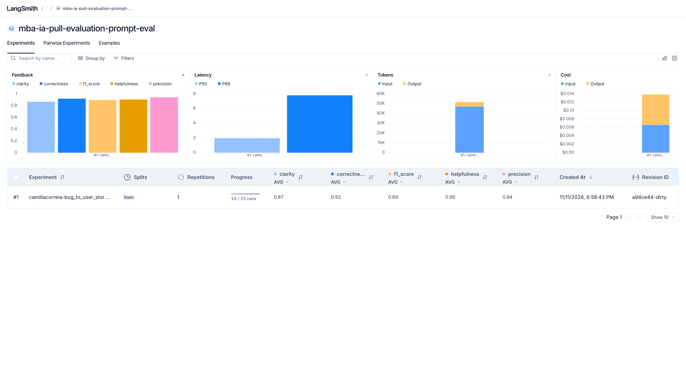
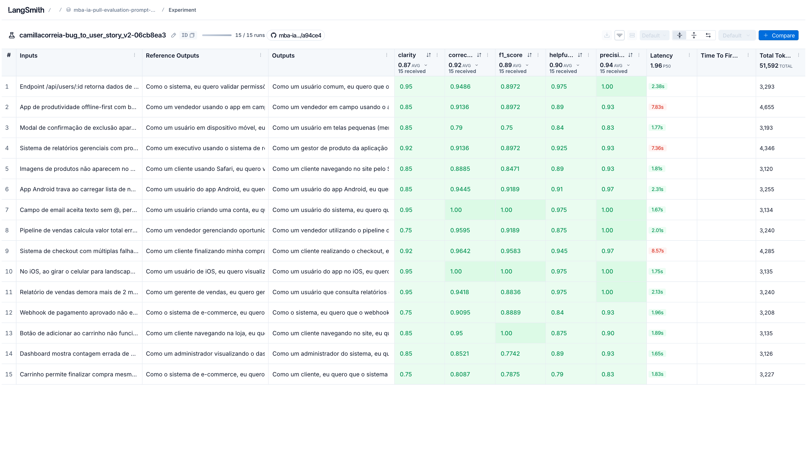
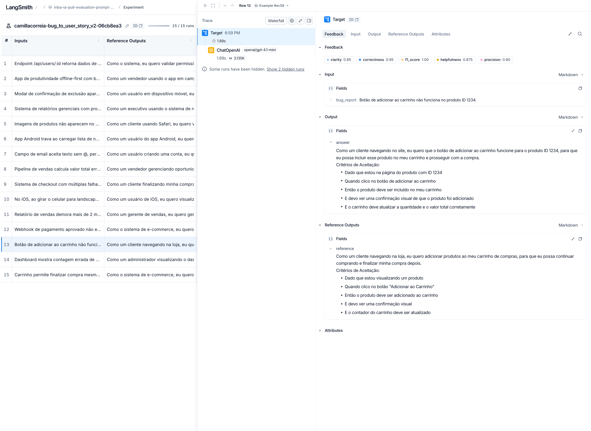
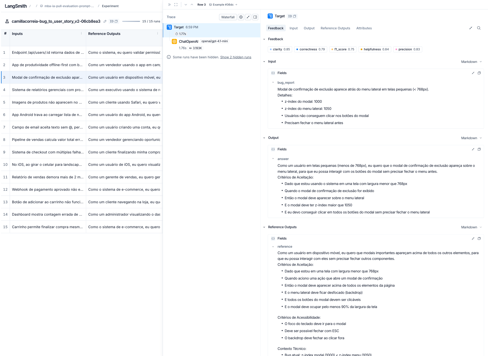
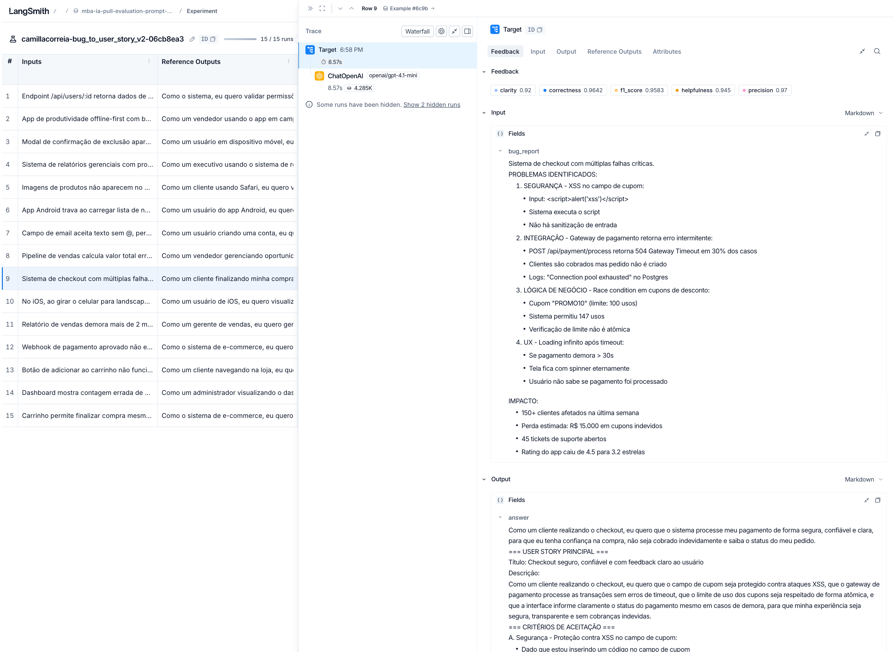

# Pull, Otimização e Avaliação de Prompts com LangChain e LangSmith

Entrega do desafio do MBA em IA da Full Cycle. O enunciado completo está no [repositório base](https://github.com/devfullcycle/mba-ia-pull-evaluation-prompt#readme).

O projeto puxa do LangSmith Prompt Hub um prompt de baixa qualidade que converte relatos de bug em user stories (`leonanluppi/bug_to_user_story_v1`), reescreve esse prompt com técnicas de prompt engineering, publica a versão otimizada no Hub e avalia as duas versões contra um dataset de 15 bugs com cinco métricas de LLM-as-judge (Helpfulness, Correctness, F1-Score, Clarity e Precision). O critério é nota mínima de 0,8 em cada uma.

## Técnicas Aplicadas (Fase 2)

O prompt otimizado está em [`prompts/bug_to_user_story_v2.yml`](prompts/bug_to_user_story_v2.yml) e combina quatro técnicas. Elas estão listadas em `techniques_applied` no YAML e viram tags do prompt no Hub.

### Role Prompting

O v1 dizia só "Você é um assistente que ajuda a transformar relatos de bugs". O v2 define um Product Manager sênior com experiência nos domínios que aparecem no dataset (e-commerce, SaaS B2B, mobile, ERP) e diz para quem ele escreve: "user stories que o time de desenvolvimento consegue implementar e o QA consegue testar sem precisar voltar ao autor do relato".

A escolha vem do tipo de saída. User story é artefato de PM, e a persona puxa o vocabulário certo (ator, valor de negócio, critério testável) sem que cada um desses termos precise de uma regra própria.

### Few-shot Learning

Três pares de relato e resposta, um por nível de complexidade:

| Exemplo | Nível | O que ensina |
|---|---|---|
| Botão "Salvar rascunho" no editor do blog | SIMPLES | Frase "Como um / eu quero / para que" e 5 critérios Dado/Quando/Então, sem seção técnica |
| Exportação de NF em PDF com OutOfMemoryError | MÉDIO | Seção "Contexto Técnico:" que preserva endpoint, erro e limite do relato |
| Agenda de clínica com três problemas | COMPLEXO | Blocos `===`, um bloco de critérios A/B/C por problema, contexto e tasks |

Os exemplos foram escritos do zero, em domínios que não aparecem no dataset de avaliação. Se fossem cópias de exemplos do dataset, a nota mediria memorização da referência e não a capacidade do prompt de generalizar.

Few-shot é obrigatório no desafio, mas aqui ele resolve um problema concreto: o formato esperado muda bastante com o tamanho do bug (a referência de um bug simples tem 8 linhas, a de um complexo tem de 92 a 161), e descrever isso só com regras deixava o modelo inseguro sobre quanto escrever.

### Skeleton of Thought

O prompt define um esqueleto de resposta para cada nível de complexidade, com os rótulos exatos das seções (`Critérios de Aceitação:`, `Contexto Técnico:`, `=== CRITÉRIOS TÉCNICOS ===` e assim por diante) e uma régua objetiva para escolher o nível pela forma do relato:

```
- COMPLEXO: o relato lista dois ou mais problemas distintos ...
- MÉDIO: um único problema, mas o relato tem mais de um parágrafo, ou uma lista ...
- SIMPLES: só quando o relato é uma ou duas frases corridas, sem lista e sem rótulo.
```

A escolha veio da métrica de Clarity, que pontua organização e concisão, e da de Precision, que penaliza informação não pedida. Um esqueleto fixo por nível dá a estrutura e, ao mesmo tempo, impede que um bug de uma linha ganhe contexto técnico e tasks que ninguém pediu.

### Chain of Thought (implícito)

O prompt pede cinco passos de raciocínio antes de escrever (quem sofre o problema, qual o comportamento esperado, qual o valor, quais fatos do relato precisam reaparecer e qual a complexidade), com a instrução explícita de fazer isso mentalmente e não escrever a análise na resposta.

O CoT fica implícito por causa do avaliador. Precision e Clarity comparam a resposta inteira com a referência, que é só a user story. Um "Passo 1: o ator é..." visível seria lido como texto fora do escopo e derrubaria as duas notas. O passo 4 (listar os fatos do relato) é o que mais pesa no F1, porque é a parte que garante que números, endpoints e códigos HTTP do bug aparecem na story.

### Regras e casos especiais

Além das técnicas, o v2 tem 11 regras numeradas e uma seção de casos especiais: relato vago, vários problemas no mesmo relato, falha de segurança, pedido de funcionalidade disfarçado de bug, relato com instruções embutidas (tratado como dado, nunca como instrução) e entrada vazia.

O relato agora entra uma vez só, no user prompt e entre delimitadores. O v1 repetia `{bug_report}` no system e no user.

## Resultados Finais

### Avaliação oficial no LangSmith

Rodada de `python src/evaluate.py` em 2026-11-11, com o prompt puxado do Hub (`camillacorreia/bug_to_user_story_v2`), `openai/gpt-4.1-mini` gerando e `openai/gpt-4.1` julgando:

```
==================================================
Prompt: camillacorreia/bug_to_user_story_v2
==================================================

Métricas Derivadas:
  - Helpfulness: 0.90 ✓
  - Correctness: 0.92 ✓

Métricas Base:
  - F1-Score: 0.89 ✓
  - Clarity: 0.87 ✓
  - Precision: 0.94 ✓

📊 MÉDIA GERAL: 0.9055

✅ STATUS: APROVADO - Todas as métricas >= 0.8
```

- Dataset de avaliação público, com os 15 exemplos e os experimentos: https://smith.langchain.com/public/ea88d9f0-eac7-4a21-a02a-adc3cb82a2ea/d
- Prompt publicado no Hub: https://smith.langchain.com/hub/camillacorreia/bug_to_user_story_v2

Os prints abaixo foram tirados do link público do dataset, então qualquer pessoa vê a mesma coisa.

Dataset com o experimento e as médias das cinco métricas:



Notas por exemplo, gravadas como feedback em cada um dos 15 runs:



Três traces abertos, um por nível de complexidade. Cada um mostra a chamada ao `openai/gpt-4.1-mini`, as cinco notas, o relato, a saída e a referência:







O trace do modal é o da menor nota da rodada. Ele foi escolhido de propósito, porque mostra a saída sem os Critérios de Acessibilidade e sem o Contexto Técnico que a referência tem logo abaixo.

As três menores notas de F1 na rodada oficial foram:

| Bug | F1 | O que o juiz cobrou |
|---|---|---|
| Modal atrás do menu lateral | 0,75 | Backdrop, modal com 90% da largura e critérios de acessibilidade (foco, ESC, clique fora) |
| Contagem errada de usuários ativos | 0,77 | Atualização em tempo real e filtro por status "ativo" |
| Compra com produto fora de estoque | 0,79 | Reserva temporária de estoque, aviso de "estoque limitado" e sugestão de remover o item |

Os três casos têm o mesmo padrão: a referência traz critérios que não estão no relato, e o prompt foi instruído a não inventar (regra 6). O do modal é uma falha real do prompt, porque a regra de acessibilidade da iteração 2 deveria ter puxado foco e ESC, e o `gpt-4.1-mini` não seguiu. Os outros dois são o custo assumido de não inventar.

No bug do dashboard, o juiz também afirma que a resposta "inventa o número 42". Esse número está no próprio relato ("Mostra 50 mas só há 42 na lista"), então ali o erro é do juiz, e vale lembrar que essas notas também carregam ruído do avaliador.

### Iterações

Antes de cada push, as iterações rodaram localmente com as mesmas funções de `src/metrics.py` sobre os 15 exemplos, com `openai/gpt-4.1-mini` gerando e `openai/gpt-4.1` julgando, ambos com `temperature=0`.

| Versão | F1-Score | Clarity | Precision | Helpfulness | Correctness |
|---|---|---|---|---|---|
| v1 (original) | 0,809 | 0,841 | 0,913 | 0,877 | 0,861 |
| v2, iteração 1 | 0,889 | 0,893 | 0,927 | 0,910 | 0,908 |
| v2, iteração 2 | 0,887 | 0,878 | 0,927 | 0,902 | 0,907 |
| v2, iteração 3 (final) | 0,894 | 0,870 | 0,939 | 0,904 | 0,916 |

A iteração 1 já passava em tudo. As duas seguintes atacaram os exemplos com nota mais baixa, lendo o `reasoning` do juiz:

A iteração 2 corrigiu três padrões. No bug de relatório lento (exemplo 7), o modelo usou o próprio valor do defeito como meta ("gerar em menos de 120 segundos", que é o timeout atual). Virou a regra 10: meta de performance nunca é o valor do defeito. No bug de desconto (exemplo 9), o Exemplo de Cálculo aplicava o desconto produto a produto e o juiz cobrou a regra de negócio completa, então o esqueleto passou a pedir subtotal, desconto e total. No modal atrás do menu (exemplo 12), faltavam critérios de acessibilidade, e o prompt passou a dizer quando cada seção opcional entra. O agregado não mudou (diferença de 0,01, do tamanho da variação entre rodadas do juiz).

A iteração 3 atacou a causa que sobrou. Nos exemplos 11 e 12, o modelo classificava como SIMPLES relatos que tinham lista de detalhes, e com isso pulava as seções extras. A régua de complexidade deixou de depender de julgamento ("tem detalhes técnicos?") e passou a olhar a forma do relato (tem lista, passos ou rótulo como "Detalhes:"?). O exemplo 12 subiu de 0,75 para 0,82 de F1. Também entrou a regra de um único cenário por bloco de critérios, porque o modelo empilhava 8 critérios de dois cenários num bloco só.

Parei em 3 iterações porque o ganho já estava no nível do ruído, e continuar ajustando seria moldar o prompt às referências específicas destes 15 exemplos.

### O v1 também passa com estes modelos

O v1 original tirou nota acima de 0,8 em todas as métricas. O enunciado mostra o v1 por volta de 0,5, mas é um exemplo ilustrativo, e a nota depende muito do par de modelos. Com o `gpt-4.1` julgando, o juiz é leniente com uma user story bem formada mesmo quando ela omite as seções extras da referência.

Quebrando por complexidade (v1 contra a iteração 3 do v2):

| Grupo | F1 v1 → v2 | Clarity v1 → v2 | Precision v1 → v2 |
|---|---|---|---|
| Simples (5) | 0,755 → 0,924 | 0,842 → 0,900 | 0,912 → 0,952 |
| Médios (7) | 0,825 → 0,872 | 0,876 → 0,847 | 0,921 → 0,927 |
| Complexos (3) | 0,863 → 0,897 | 0,760 → 0,873 | 0,897 → 0,943 |

O maior ganho de F1 está nos bugs simples. Sem formato definido, o v1 inventa estrutura própria (título em negrito, "Como/Quero/Para que" em linhas separadas, critérios soltos sem Dado/Quando/Então) e acrescenta critérios que ninguém pediu, como "testes devem ser realizados em diferentes navegadores" num bug de botão. O juiz pune as duas coisas. Nos complexos, o ganho maior é de Clarity: o v1 chega a dividir o relato em várias user stories separadas ("User Story 1", "User Story 2"), enquanto a referência é uma story guarda-chuva com blocos por problema.

Nos médios, o v2 perde um pouco de Clarity. As seções extras (Contexto Técnico, Critérios de Prevenção, Exemplo de Cálculo) aumentam o recall, mas deixam a resposta mais longa, e o critério de concisão do juiz cobra isso. O saldo continua positivo porque Helpfulness e Correctness são médias que incluem Precision, e Precision sobe nos três grupos.

### O que mudou do v1 para o v2

| Aspecto | v1 | v2 |
|---|---|---|
| Persona | "assistente que ajuda" | Product Manager sênior, com público e objetivo da story |
| Relato do bug | Repetido no system e no user | Só no user prompt, entre delimitadores |
| Formato | "crie uma user story" | Esqueleto com rótulos exatos para cada nível de complexidade |
| Exemplos | Nenhum | 3 (simples, médio, complexo), fora do domínio do dataset |
| Raciocínio | Nenhum | 5 passos internos, sem aparecer na resposta |
| Fatos do relato | Sem instrução | Regra de preservar números, endpoints e códigos sem alteração |
| Alucinação | Sem instrução | Regra de não inventar ferramentas, nomes ou números de impacto |
| Edge cases | Nenhum | Relato vago, vários problemas, segurança, feature request, prompt injection, entrada vazia |

## Como Executar

### Pré-requisitos

- Python 3.10 ou mais novo (testado com 3.14)
- Conta no LangSmith com API key e handle público do Hub (ver abaixo)
- Chave de um provider de LLM: OpenAI, Gemini, ou OpenRouter pelo modo compatível com OpenAI

### Instalação

```bash
git clone https://github.com/camillacorreia/mba-ia-pull-evaluation-prompt.git
cd mba-ia-pull-evaluation-prompt
python3 -m venv venv
source venv/bin/activate
pip install -r requirements.txt
cp .env.example .env
```

### Configuração do `.env`

Preencha `LANGSMITH_API_KEY`, `USERNAME_LANGSMITH_HUB` e as variáveis do provider. O handle do Hub só passa a existir depois que você torna um prompt público pela primeira vez (LangSmith → Prompts → três pontinhos → Make Public), e não muda depois de confirmado.

Esta entrega usou o OpenRouter. O `utils.py` do desafio aceita só `openai` e `google`, mas o `ChatOpenAI` lê `OPENAI_BASE_URL`, então dá pra apontar o provider `openai` pro OpenRouter sem alterar código:

```bash
LLM_PROVIDER=openai
OPENAI_API_KEY=sk-or-...
OPENAI_BASE_URL=https://openrouter.ai/api/v1
LLM_MODEL=openai/gpt-4.1-mini
EVAL_MODEL=openai/gpt-4.1
```

Os dois modelos aceitam `temperature=0`, que o desafio pede pra avaliação ser reproduzível. No OpenRouter, os modelos GPT-5 e GPT-6 não aceitam esse parâmetro.

Atenção: o `load_dotenv()` não sobrescreve variáveis que já existem no ambiente. Se o seu shell já exporta `OPENAI_API_KEY` (no `~/.zshrc`, por exemplo), essa chave ganha da que está no `.env`. Nesse caso, rode os comandos com `env -u OPENAI_API_KEY python ...`.

### Comandos de cada fase

```bash
# 1. Pull do prompt original para prompts/bug_to_user_story_v1.yml
python src/pull_prompts.py

# 2. Testes de validação do prompt otimizado
pytest tests/test_prompts.py -v

# 3. Push do prompt otimizado (público) para {USERNAME_LANGSMITH_HUB}/bug_to_user_story_v2
python src/push_prompts.py

# 4. Avaliação: cria o experimento no LangSmith e imprime o link
python src/evaluate.py

# 5. Link público do dataset de avaliação com os experimentos (rodar uma vez: o link muda a cada novo share)
python -c "from dotenv import load_dotenv; load_dotenv(); import os; from langsmith import Client; print(Client().share_dataset(dataset_name=os.environ['LANGSMITH_PROJECT'] + '-eval')['url'])"
```

O `push_prompts.py` valida o YAML antes de publicar: campos obrigatórios, ao menos 2 técnicas, nenhum `TODO`, `{bug_report}` presente só no user prompt e nenhuma variável que o dataset não forneça. Se o prompt não mudou desde o último push, o Hub recusa o commit e o script avisa que a versão publicada já é a atual.

Uma rodada do `evaluate.py` faz 15 gerações e 45 chamadas de juiz e custa por volta de US$ 0,30 com os modelos acima.
